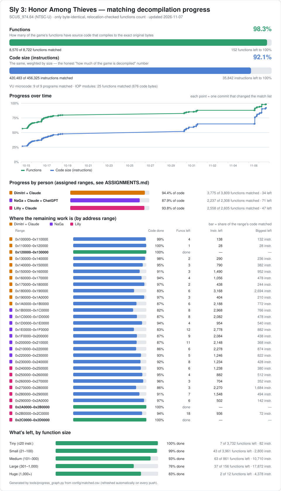

# Sly 3: Honor Among Thieves

Matching decompilation of the USA PlayStation 2 release, `SCUS_974.64`.



Coverage counts complete, byte-matching source implementations. Preserved game
bytes do not count. The full game is not yet rebuilt entirely from source.

## Build

Requires Python 3.12+, Windows, and the original USA disc image.

```powershell
python -m venv .venv
.venv\Scripts\python -m pip install -r requirements.lock.txt
.venv\Scripts\python tools/bootstrap.py
.venv\Scripts\python tools/extract_disc.py "Sly 3 (USA).iso"
.\sly3.ps1 build
```

VU sources use GNU `dvp-as` 2.45.1:

```powershell
.venv\Scripts\python tools/build_vu_sources.py --assembler path/to/dvp-as.exe
```

`src/` contains EE and VU implementations; `iop/src/` contains IOP implementations.
Compiler profiles are recorded in each source file. The full research verification
pipeline additionally uses local review evidence, which is excluded from Git.

Game files, SDK/compiler binaries, and generated build files are not included.
